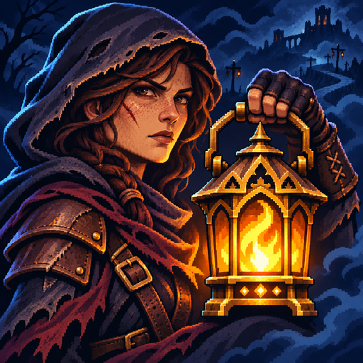

*Harrowick* has enough campaign and company systems now that handing someone the full game is a fairly large request. I also want a shorter version that lets them understand the lantern escort, try a company and reach an ending to that particular expedition.

The limited demo uses two roads. All nine heroes remain available, so the restriction falls on the length of the journey rather than the choice of company. The full campaign remains separate.

That gives the demo a useful job. It should show why the player might leave the wagon to explore, why coming back matters, and how the Rogue, Tank and Mage change the opportunities along the way. If those things are confusing in two roads, adding eight more will give the player a longer opportunity to be confused.

## Keep the company choices

The player moves the Rogue while the Tank and Mage act automatically. That is the central distinction the [recent interface work](../../stories/harrowick-learning-to-read-the-road/) has been trying to communicate.

Keeping the nine-hero roster in the demo means a tester can approach the same limited journey with different companies. Mara's backstabs, Orrin's traps and Vesper's lower threat offer different reasons to move. The supporting roles should make those approaches more interesting as well.

I want feedback about those differences. Did the player notice when a companion created an opening? Did they understand why an enemy could be hurt from one direction and protected from another? Was there a reason to return to the lantern before the situation became hopeless?

A short demo cannot prove that every company will remain satisfying through a full campaign. It can help establish whether the differences are visible early enough to matter.

## A stopping point with a purpose

The limited build has its own completion boundary. It should finish as a demo rather than appear to break when the player tries to continue into unavailable content. That boundary also needs to survive saving and resuming.

Feedback is optional and stays under the tester's control. The existing tools keep a draft on the device and let the tester choose when to share it. I would rather hear that a particular camp choice was difficult to find than receive a score with no idea what produced it.

There is still a use for the full-campaign tester build. It can reveal problems much later in an expedition. The two-road demo answers a narrower question: does the opening make enough sense that someone wants another road?

Neither version should quietly replace the other's saves. The limited demo has its own application identity, so it can sit beside the full game. That separation now carries through to iOS packaging too.

## Put the lantern in someone's hand

The earlier icon used the lantern as an emblem. The new version keeps the ornate brass lantern and brings a hooded escort into the frame, with the flame lighting her face against the blue of the road behind her.

I liked the new *Stancebreaker* icon and wanted a similar level of pixel-art detail for *Harrowick*. The two games need different moods. Red gloves and combat cards can explain something about *Stancebreaker* immediately. Here, the person carrying the light matters as much as the object itself.

This is key art for the game, rather than the announcement of another playable hero. The lantern remains the recognisable part of the image, and the background is kept darker so it can survive being reduced to a small launcher icon.

Both the full and limited demo builds receive the new artwork. The source image is exported into Android's legacy and adaptive launcher sizes, an opaque iOS icon, and web icons. The adaptive versions leave room for the platform's mask. Those exports still need checking on real launchers; a square preview cannot show every crop a phone might apply.

## Four build choices, with clear names

Each game now has four mobile build entrypoints: an APK for the full game, an iOS package for the full game, a demo APK and a demo iOS package.

The point is to make the choice explicit before the build starts. A tester asking for the demo should receive the content-limited version. The package should identify which source revision produced it, and the workflow should reject a full/demo mismatch rather than give the wrong file a convincing name.

*Harrowick* already had an iOS project in the repository. This work connects it to a repeatable packaging path, synchronises its display name and identity with the chosen edition, and adds verification of the bundled offline game. The existing native identifiers and save compatibility are retained for the full game.

An iOS build can produce a simulator app and an unsigned device archive without a signing account being configured in the workflow. Installing on an iPhone needs the appropriate signed build. The optional IPA export takes a certificate and a matching profile for that edition; it does not submit the game to Apple.

The distinction needs to be visible in the download. Calling an unsigned archive an installable iPhone build would save a few words and cost a tester considerably more time.

Builds also include checksums and source information. Downloads are being kept as unpublished draft releases because the account's Actions artifact storage is full. That is a practical delivery choice, not an announcement that either game has been released.

## The next test is still on a phone

The [full-game PR](https://github.com/peterdsouza247/last-lantern/pull/32) and [limited-demo PR](https://github.com/peterdsouza247/last-lantern/pull/33) contain the icon and packaging work. Automated checks cover the source, demo limits and offline files inside the package. Native compilation establishes that the Android and iOS projects can build. Signed distribution and physical-device acceptance remain separate work.

What I want from the next phone test is fairly specific. Can someone choose a company without needing an explanation from me? Can they read a dangerous attack while moving? Can they find the choice after a guardian? When they stop and return later, does the expedition resume where they expect?

The larger 3D lantern-escort idea remains future work. The current game has a more immediate responsibility: give someone two roads that make them curious about the rest of Harrowick.
