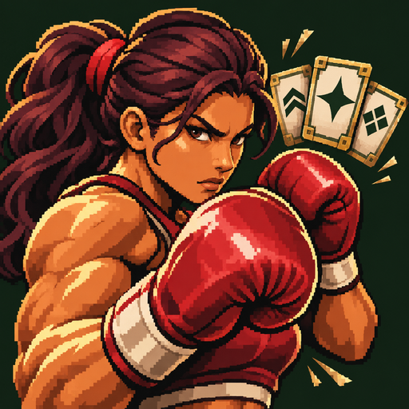

I wanted to see the whole card. I also wanted to see the characters perform the move. On a phone, those two fairly reasonable requests had started competing with each other.

Scrolling down to read a technique could put the fighters out of view. That is a particular problem for *Stancebreaker*, because the animation is supposed to explain what the card achieved. If a throw changes who is on top, the player should be able to connect the written rule to the exchange on screen.

The latest work has been about giving the cards, fighters and decisions enough room to work together. It has also been a chance to borrow more of the ceremony of a fighting game: choosing a portrait, seeing a character take their stance, facing the next opponent and getting an ending worth reaching.

## Keep the arena in view

The combat screen now works within the available viewport. The arena, hand and important actions have defined places, with the focused card's information kept alongside the fight. Browsing a hand still needs movement; moving the entire page just to reach the next decision should be avoidable.

This follows the two-tap selection work in the [previous journal](../../stories/stancebreaker-making-cards-feel-like-a-fight/). The first tap lifts a card into consideration. The second plays it. The player needs room to make that first decision without losing the context of the current stance, range or position.

The title screen had a related problem. The menu covered the sparring artwork. In portrait, the characters now have space above the options; in landscape, they sit to the right, with the options using the space to the left. That arrangement gives the picture a purpose beyond being something attractive underneath a button.

Small screens still need careful judgement about text size and touch targets. Automated layout checks are useful for finding clipped actions. Comfort under a thumb will need phone testing.

## Choose a fighter from a portrait

I wanted character selection to feel closer to a fighting game. A roster of portraits is a better starting point than a long page that makes each fighter compete for vertical space.

Selecting a portrait brings up the larger pixel-art character in a ready pose, with a little movement to keep the screen alive. Deck information and biography sit beside the preview, with tabs keeping both available. The player can compare choices without scrolling past the previous character's entire introduction.

The deck and biography answer different questions. The deck explains what this fighter tends to do. The biography gives a reason to care who is doing it. I would like a player to choose a style because it sounds interesting, then find that the character gives them a reason to stick with it.

The selected portrait and preview also need to agree. A pleasant animation cannot compensate for uncertainty about which fighter will enter the match.

## Give each bout an entrance

A detailed VS screen now puts both fighters in ready poses before the match. It gives the next opponent a face and a stance before the cards arrive. The match presentation then makes room for ready, victory and defeat states.

These moments need a different pace from an ordinary card exchange. There should be time to recognise the opponent and enjoy the artwork, with a way forward that does not leave the player wondering whether the game is waiting for them. Fast and reduced-motion settings need to remain useful too.

The tournament opponent order is shuffled when a run begins and saved with that run. Resuming should bring back the same opponent sequence. A new run can change the order, but loading a save should never quietly replace the player’s next fight.

At the end of a successful tournament, the chosen fighter gets a congratulatory screen with a larger victory pose and an ending drawn from their biography. There are individual resolutions for the roster. I wanted the final win to feel like the end of that character's journey, rather than another bout result with a longer score.

## Let the rules provide the callouts

Combo cues, counter reveals and fighting-game callouts are now part of the presentation. Their usefulness depends on being specific about what happened.

A combo cue should point towards an existing interaction in the cards. It should not promise a bonus the rules do not award. A counter reveal should arrive when the counter triggers, without giving away an opponent's hidden hand beforehand. A finishing callout should reflect the actual result, whether the bout ended through damage, a submission or a decision.

That distinction matters in a card game. Reading the opponent is part of the fight; receiving information the player was never meant to have would change the rules. The cues follow the shared combat events, so the dramatic explanation has to agree with the resolved action.

I am keeping signature finishers and special rival encounters in the future-work document. Both could give the roster more personality, but they need more design than adding another large word to the screen. A finisher needs a clear trigger and a sensible effect on pacing. A rivalry needs something to say about the characters across repeated encounters. Neither is being presented as a completed feature here.

## An icon and a build someone can identify

The new icon puts Reyes's face and red gloves in front of a small fan of combat cards. That is the combination I want the game to communicate when it is reduced to a square on a phone: a fighter, with cards involved in the fight.

The same artwork is going into the full and demo editions, with different app names and separate identities. The limited demo keeps Boxing, Judo and Brazilian Jiu-Jitsu, a 34-card pool and a three-bout tournament. Its feedback tools remain available. I want someone trying it to reach a proper stopping point and have a straightforward way to tell me what confused them.

There are also four explicit build routes now: full APK, full iOS package, demo APK and demo iOS package. The iOS path includes a native save implementation for *Stancebreaker*, so reaching an iPhone is more than a matter of putting the existing page inside a different shell.

The build downloads identify their edition and source commit. Simulator apps and unsigned device archives can be compiled without Apple signing credentials; a signed IPA needs the appropriate certificate and provisioning profile. An unsigned archive is not an iPhone installer. The new workflows prepare those exports without automatically sending anything to an app store.

These changes are being reviewed in the [full-game PR](https://github.com/peterdsouza247/stancebreaker/pull/19) and [limited-demo PR](https://github.com/peterdsouza247/stancebreaker/pull/20). Automated rules, layout and native build checks are useful evidence. They still leave an important test for an actual phone: can a new player read a technique, watch its effect and choose the next card without fighting the interface?
